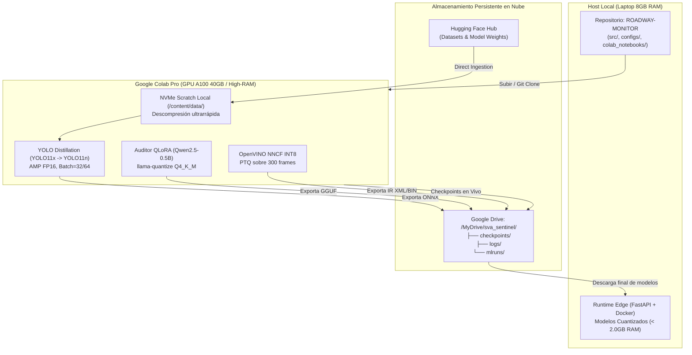

# Guía Rápida: Entrenamiento y Destilación en Google Colab con GPU A100

> **SVA Residential Traffic & Micromobility Safety Sentinel**  
> Documento operativo para la ejecución en la nube (Google Colab Pro / GPU A100 / L4) y sincronización con el host local Edge.

---

## 1. Arquitectura de Sincronización Nube-Edge

El entrenamiento y la destilación pesada se ejecutan en Google Colab para aprovechar aceleradores de cómputo de alto rendimiento (GPU NVIDIA A100-SXM4 de 40GB/80GB o L4 de 24GB). Los modelos optimizados resultantes se transfieren a la laptop local para operar bajo un presupuesto estricto de memoria RAM ($\le 4\text{GB}$ para el contenedor de inferencia Edge en Docker).



---

## 2. Estado de los Datos en Local vs. En la Nube

| Componente | Estado Local | Estrategia Recomendada |
|---|---|---|
| **Scripts de Ingesta y Curación** | Implementados y probados (`src/pipeline/`) | Ejecutar directamente en Colab. |
| **Archivos de Imagen Reales** | No descargados en local (0 MB) | Descargar en Colab vía Hugging Face Hub aprovechando su ancho de banda Gigabit (~1.5 Gbps) y disco NVMe de 150GB. |
| **Modelos Base Pre-entrenados** | Registrados en `models/base/registry.json` | Descarga automática en Colab vía SafeTensors / Ultralytics. |

---

## 3. Preparación Inicial en Google Drive

1. En tu Google Drive personal, crea la carpeta raíz del proyecto:
   ```text
   Mi unidad / sva_sentinel /
   ├── checkpoints /
   ├── logs /
   └── mlruns /
   ```
2. Esta carpeta persistirá automáticamente todos los pesos y logs intermedios incluso si la sesión de Colab se desconecta por inactividad.

---

## 4. Pipeline 1: Ingesta y Curación del Dataset en Colab

Abre una celda de terminal o notebook en Colab y clona el proyecto:

```bash
# 1. Clonar repositorio y entrar a la raíz
!git clone https://github.com/tu-usuario/ROADWAY-MONITOR.git /content/ROADWAY-MONITOR
%cd /content/ROADWAY-MONITOR

# 2. Instalar el paquete en modo editable y librerías clave
!pip install -q -e .
!pip install -q ultralytics onnx onnxruntime mlflow pydantic supervision psutil

# 3. Descarga de datasets desde Hugging Face Hub al disco NVMe local
!python -m src.pipeline.dataset_ingest --all-profiles --raw-dir /content/data/raw

# 4. Normalización de anotaciones heterogéneas a formato YOLO TXT con ontología canónica:
# 0: car | 1: motorcycle | 2: bicycle | 3: e-scooter | 4: pedestrian
!python -m src.pipeline.dataset_curation --format yolo --input /content/data/raw --output-images /content/data/curated/images --output-labels /content/data/curated/labels

# 5. Particionado determinista 70/20/10 con verificación de integridad SHA256
!python -m src.pipeline.dataset_split --curated-dir /content/data/curated --seed 42
```

---

## 5. Pipeline 2: Destilación de Conocimiento YOLO con GPU A100

Abre el notebook: [`colab_notebooks/01_yolo_knowledge_distillation.ipynb`](file:///D:/ROADWAY-MONITOR/colab_notebooks/01_yolo_knowledge_distillation.ipynb).

### Configuración del Entorno de Colab:
- **Entorno de ejecución:** GPU.
- **Tipo de GPU:** **A100** (VRAM $\ge 40\text{GB}$).
- **Forma del entorno:** **High-RAM** (51GB - 83GB de memoria de sistema).

### Ejecución de Celdas:
1. **Paso 1 — Hardware Check:** Valida que la GPU sea NVIDIA A100 y que CUDA esté activo.
2. **Paso 2 — Montaje de Drive:** Monta `/content/drive/MyDrive/sva_sentinel/checkpoints`.
3. **Paso 3 — Datos en Scratch NVMe:** Apunta el loader a `/content/data/curated/` y valida el manifiesto `manifest.json`.
4. **Paso 4 & 5 — Hiperparámetros de Destilación:**
   ```python
   hp = DistillationHyperparameters(
       alpha=1.0,          # Peso hard loss supervisada
       beta=2.5,           # Peso destilación de logits (dark knowledge)
       gamma=0.5,          # Peso alineación de características intermedias
       temperature=3.0,    # Temperatura tau de relajación softmax
       learning_rate=1e-3, # Optimizador AdamW
       batch_size=32,      # Optimizado para VRAM A100 (ampliable a 64)
       epochs=50,          # Ciclo completo de convergencia
       mixed_precision=True # AMP FP16 activado
   )
   ```
5. **Paso 6 — Entrenamiento:** El `DistillationTrainer` calcula la pérdida compuesta $\mathcal{L}_{total} = \alpha \mathcal{L}_{hard} + \beta \mathcal{L}_{KD} + \gamma \mathcal{L}_{feat}$ salvando `best.pt` en Drive.
6. **Paso 7 — Exportación a ONNX:**
   - Exporta el modelo del estudiante a ONNX dinámico: `models/distilled/yolo11n_distilled.onnx`.
   - Dimensiones de entrada con dynamic batching: `[B, 3, 640, 640]`.
7. **Paso 8 — Reporte de Aceptación:** Verifica retención de $\text{mAP@50} \ge 92\%$ del Teacher y reducción de parámetros $> 80\%$.

---

## 6. Pipeline 3: Fine-Tuning QLoRA y Cuantización GGUF del Auditor Forense

Abre el notebook: [`colab_notebooks/02_auditor_finetuning_llamacpp.ipynb`](file:///D:/ROADWAY-MONITOR/colab_notebooks/02_auditor_finetuning_llamacpp.ipynb).

1. **Generación de Telemetría Sintética:**
   - Genera 1,000 registros balanceados de infracciones de tránsito residencial en formato ChatML JSONL (`sva-generate-telemetry`).
2. **Entrenamiento QLoRA NF4:**
   - Ajusta el modelo base Qwen2.5-0.5B-Instruct con adaptadores LoRA ($r=16, \alpha=32$).
3. **Fusión y Exportación FP16:**
   - Fusiona los adaptadores en un modelo unificado standalone en precisión FP16 (`sva-finetune-auditor`).
4. **Cuantización Q4_K_M GGUF:**
   - Compila `llama-quantize` en Colab.
   - Ejecuta la cuantización de 4 bits con k-quants medios:
     ```bash
     !sva-quantize-gguf \
       --input-f16 models/auditor/qwen2.5-0.5b-auditor-f16.gguf \
       --output-gguf /content/drive/MyDrive/sva_sentinel/checkpoints/qwen2.5-0.5b-auditor-q4_k_m.gguf
     ```
   - Confirma reducción de tamaño $\ge 55\%$ ($< 450\text{MB}$).
5. **Evaluación de 100 Casos:**
   - Valida parseo estricto del esquema JSON `IncidentAuditVerdict` con $100\%$ de éxito y exactitud $\ge 90\%$.

---

## 7. Pipeline 4: Cuantización OpenVINO NNCF INT8 para CPU Edge

Abre el notebook: [`colab_notebooks/03_openvino_int8_quantization.ipynb`](file:///D:/ROADWAY-MONITOR/colab_notebooks/03_openvino_int8_quantization.ipynb).

1. Toma el `yolo11n_distilled.onnx` exportado en el Pipeline 2.
2. Utiliza 300 cuadros de calibración equilibrados por iluminación (120 día, 90 atardecer, 90 noche).
3. Aplica Post-Training Quantization (PTQ) con OpenVINO NNCF:
   - Reducción de tamaño del modelo $\ge 60\%$.
   - Caída de precisión $\Delta \text{mAP} \le 1.5\%$.
4. Exporta la representación intermedia (IR):
   - `yolo11n_int8.xml`
   - `yolo11n_int8.bin`
5. Ejecuta el benchmark de CPU en Colab:
   - Rendimiento objetivo: $\ge 25\text{ FPS}$ en CPU y memoria RSS $< 1.2\text{GB}$.

---

## 8. Integración con MLflow

Para monitorizar las métricas en tiempo real mientras Colab entrena:

### Opción A: Conexión a tu Docker Local vía Túnel Ngrok
1. En tu laptop local levanta el servidor de MLflow:
   ```bash
   docker compose up -d mlflow-server
   ```
2. Abre un túnel hacia el puerto 5000:
   ```bash
   ngrok http 5000
   ```
3. En Colab, establece la URL de Ngrok antes de iniciar el entrenamiento:
   ```python
   import os
   os.environ["MLFLOW_TRACKING_URI"] = "https://tu-subdominio.ngrok-free.app"
   ```

### Opción B: Persistencia Directa en Google Drive
Si no deseas abrir puertos:
```python
import os
os.environ["MLFLOW_TRACKING_URI"] = "file:///content/drive/MyDrive/sva_sentinel/mlruns"
```
Al finalizar el entrenamiento, sincronizas la carpeta `mlruns` a tu laptop y visualizas los gráficos localmente con `mlflow ui`.

---

## 9. Sincronización Final hacia la Laptop Local

Descarga los modelos optimizados desde tu Google Drive y colócalos en las siguientes carpetas locales de tu repositorio:

```text
ROADWAY-MONITOR /
└── models /
    ├── distilled /
    │   ├── yolo11n_distilled.pt
    │   └── yolo11n_distilled.onnx
    └── quantized /
        ├── openvino /
        │   ├── yolo11n_int8.xml
        │   └── yolo11n_int8.bin
        └── llamacpp /
            └── qwen2.5-0.5b-auditor-q4_k_m.gguf
```

---

## 10. Checklist de Verificación Final

Antes de desplegar en producción Edge, verifica los siguientes hitos en tu máquina local:

- [ ] `yolo11n_distilled.onnx` generado con dynamic batching `[B, 3, 640, 640]`.
- [ ] `yolo11n_int8.xml` y `.bin` cuantizados a INT8 ocupando $< 15\text{MB}$ de disco.
- [ ] `qwen2.5-0.5b-auditor-q4_k_m.gguf` con tamaño inferior a $450\text{MB}$.
- [ ] Ejecución de `./init.sh` en local con **100% de tests pasando en verde**.
- [ ] Consumo combinado de memoria en el Edge API: $\le 2.0\text{GB}$ RAM (dentro del presupuesto de 4GB del contenedor y 8GB del host).
