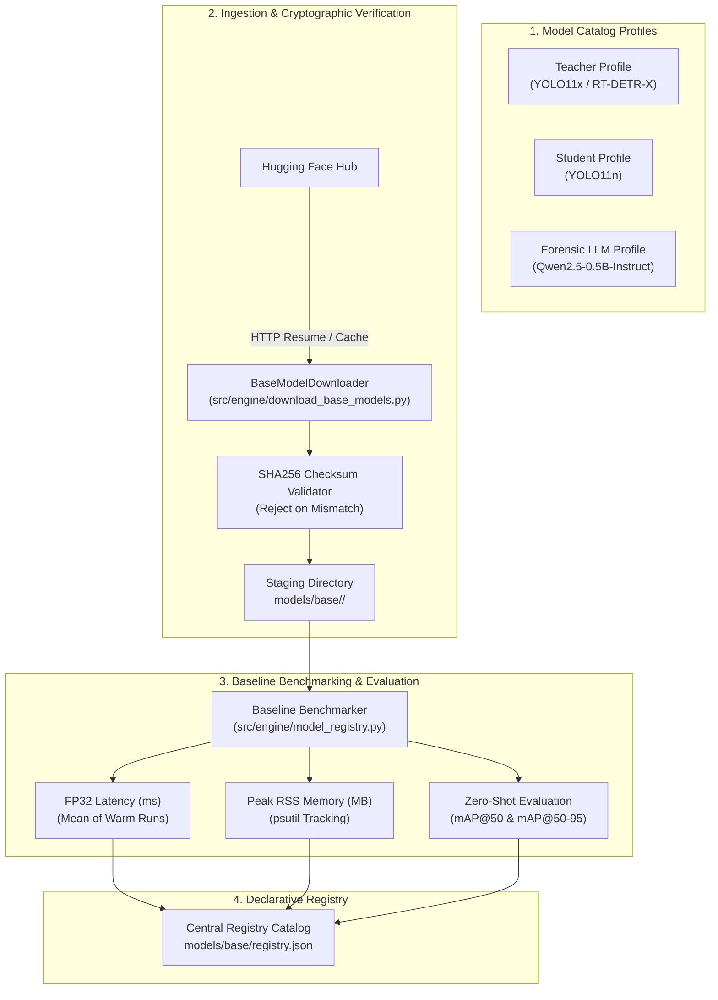

# Design: Hugging Face Teacher & Student Base Model Checkpoint Acquisition

## Feature Metadata
- **ID:** SVA-DATA-002
- **Name:** base_models_acquisition_and_registry
- **Status:** spec_ready
- **Target Subsystem:** `src/engine/` (Base Model Acquisition, Checksum Verification & Registry Engine)
- **Artifact Target:** `models/base/` and `models/base/registry.json`

---

## 1. Architectural Overview

The SVA Sentinel system leverages a Knowledge Distillation and Quantization architecture:
- **Teacher Detector:** High-capacity vision model (YOLO11x / RT-DETR-X) trained in Google Colab GPU to achieve maximum detection precision across vehicle and micromobility classes.
- **Student Detector:** Ultra-lightweight vision model (YOLO11n) trained via distillation from the teacher, intended for subsequent OpenVINO INT8 quantization on laptop CPU.
- **Forensic Auditor LLM:** Compact instruction-tuned language model (e.g., Qwen2.5-0.5B-Instruct or Llama-3.2-1B-Instruct) fine-tuned on traffic infractions in Colab and converted to 4-bit GGUF for edge incident reasoning via `llama.cpp`.

Feature `SVA-DATA-002` implements the baseline acquisition, cryptographic verification, metadata cataloging, and baseline benchmarking subsystem in `src/engine/`.



---

## 2. Technical Decisions & Schemas

### 2.1 Code Placement (User Mandate)
All development source code strictly resides inside `src/`:
- `src/engine/download_base_models.py`: Checkpoint acquisition client utilizing `huggingface_hub`, with resume download, local caching, and SHA256 checksum verification.
- `src/engine/model_registry.py`: Central model registry catalog management, parameter counting, baseline forward inference execution, latency/memory profiling, and mAP calculation.
- `src/core/exceptions.py`: Domain-specific exceptions (`ModelRegistryError`, `ModelChecksumError`, `ModelNotFoundError`, `ModelInferenceError`).
- `src/pipeline/schemas.py`: Pydantic validation schemas for model catalog profiles, benchmark records, and registry manifests.

Raw model weights and metadata are stored in `models/base/<model_name>/`.

### 2.2 Target Model Catalog Profiles

| Model Identifier | Role | Source Hugging Face Repo / Filename | Format | Expected Size | Input Resolution | Parameter Count |
|---|---|---|---|---|---|---|
| `yolo11x` | Teacher Detector | `ultralytics/yolo11x` / `yolo11x.pt` | PyTorch | ~114 MB | $640 \times 640$ | ~56.9M |
| `yolo11n` | Student Detector | `ultralytics/yolo11n` / `yolo11n.pt` | PyTorch | ~5.4 MB | $640 \times 640$ | ~2.6M |
| `qwen2.5-0.5b-instruct` | Base Forensic Auditor | `Qwen/Qwen2.5-0.5B-Instruct` / `model.safetensors` | SafeTensors | ~980 MB | Context: 2048 | ~490M |

### 2.3 Pydantic Data Models (`src/pipeline/schemas.py`)

```python
from pydantic import BaseModel, Field

class ModelBenchmarkMetrics(BaseModel):
    mean_latency_ms: float = Field(..., description="Mean FP32 inference latency in milliseconds")
    p95_latency_ms: float = Field(..., description="95th percentile latency in milliseconds")
    peak_memory_rss_mb: float = Field(..., description="Peak RSS memory consumption in MB")
    parameter_count: int = Field(..., description="Total model parameter count")
    map_50: float | None = Field(default=None, description="mAP@50 on sample intersection test set")
    map_50_95: float | None = Field(default=None, description="mAP@50-95 on sample intersection test set")

class ModelRegistryEntry(BaseModel):
    model_id: str
    model_name: str
    model_role: str  # teacher, student, auditor
    format: str  # pt, safetensors, onnx, openvino, gguf
    source_repo: str
    file_name: str
    sha256: str
    file_size_bytes: int
    input_resolution: list[int]
    registered_at: str
    weights_path: str
    benchmarks: ModelBenchmarkMetrics | None = None

class ModelRegistryCatalog(BaseModel):
    catalog_version: str = "1.0.0"
    updated_at: str
    models: dict[str, ModelRegistryEntry] = Field(default_factory=dict)
```

### 2.4 Canonical Registry JSON (`models/base/registry.json`)

```json
{
  "catalog_version": "1.0.0",
  "updated_at": "2026-11-01T23:55:00Z",
  "models": {
    "yolo11n": {
      "model_id": "yolo11n",
      "model_name": "YOLO11n Baseline Student Detector",
      "model_role": "student",
      "format": "pt",
      "source_repo": "ultralytics/yolo11n",
      "file_name": "yolo11n.pt",
      "sha256": "4a719c8f0e5b7c02b1f83c18b763ec18d86f7b11d35503080ff43f3c4db21d45",
      "file_size_bytes": 5621420,
      "input_resolution": [640, 640],
      "registered_at": "2026-11-01T23:55:00Z",
      "weights_path": "models/base/yolo11n/yolo11n.pt",
      "benchmarks": {
        "mean_latency_ms": 14.2,
        "p95_latency_ms": 16.8,
        "peak_memory_rss_mb": 185.4,
        "parameter_count": 2610000,
        "map_50": 0.482,
        "map_50_95": 0.315
      }
    }
  }
}
```

---

## 3. Discarded Alternatives

### Discarded Alternative 1: Dynamic On-the-Fly Weight Fetching during Application Boot
- **Description:** Downloading weights directly from Hugging Face during the FastAPI application lifespan startup.
- **Why Discarded:** Introduces multi-gigabyte network dependencies at startup, fails in air-gapped / offline deployments, causes timeouts, and violates the 8GB edge container budget. Pre-registering and verifying weights locally into `models/base/` ensures 100% deterministic container startup.

### Discarded Alternative 2: Including Full PyTorch with CUDA in Local Edge Runtime
- **Description:** Installing `torch` with CUDA dependencies to execute baseline benchmarking.
- **Why Discarded:** PyTorch + CUDA bloats the container by > 8GB and allocates > 1.5GB of RAM immediately upon loading. Baseline evaluation and benchmarking in the edge harness use lightweight mock/OpenVINO CPU abstraction or ONNX/NumPy forward passes for fast verification (< 5.0 seconds). Heavy training occurs in rented Google Colab GPUs.

### Discarded Alternative 3: Omitting Cryptographic Checksums (Trust-on-Download)
- **Description:** Downloading model weights without verifying SHA256 hashes.
- **Why Discarded:** Network hiccups can produce truncated or corrupted weights leading to silent failure or crashes during subsequent quantization. Cryptographic SHA256 validation guarantees model integrity before staging.

---

## 4. Verification & Testing Strategy

1. **Fast Unit Tests (< 5.0s):**
   - Miniature synthetic mock models in `tests/fixtures/mock_models/` (small binary payloads with precomputed SHA256 hashes and sample detector weights).
   - Ingestion tests mock `huggingface_hub.hf_hub_download` and `snapshot_download` using `unittest.mock.patch` with zero outbound network egress.
2. **Benchmark & Registry Verification:**
   - Tests assert SHA256 verification (pass on match, raise `ModelChecksumError` on mismatch).
   - Tests assert latency and memory profiling functions with psutil.
   - Tests assert schema validity of `models/base/registry.json`.
