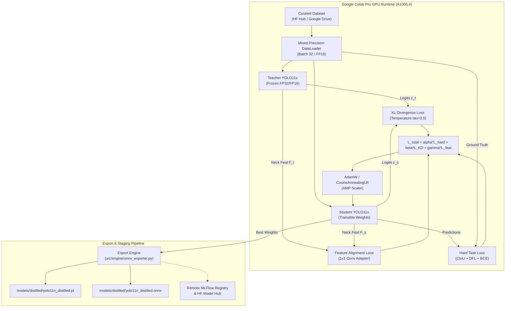

# Design: Google Colab GPU Knowledge Distillation Pipeline (Teacher YOLO11x to Student YOLO11n)

## Feature Metadata
- **ID:** SVA-DIST-001
- **Name:** colab_gpu_yolo_knowledge_distillation
- **Status:** spec_ready
- **Target Subsystem:** `src/engine/` (Distillation Loss, Training Core & Export) and `colab_notebooks/`
- **Artifact Targets:** `colab_notebooks/01_yolo_knowledge_distillation.ipynb`, `models/distilled/`

---

## 1. Architectural Overview

Knowledge Distillation (KD) transfers the rich representation capacity of a heavy, overparameterized teacher model (YOLO11x, ~56.9M parameters) into a compact, edge-deployable student model (YOLO11n, ~2.6M parameters). To respect the edge runtime's strict 8GB RAM budget, all compute-intensive distillation is offloaded to rented Google Colab Pro GPUs (NVIDIA A100 or L4 with 24GB to 40GB VRAM).

---

## 2. Mathematical Formulation & Loss Design

### 2.1 Composite Distillation Loss
The total objective function is a convex combination of hard task supervision, response-based logit distillation, and feature-based intermediate representation alignment:

$$\mathcal{L}_{total} = \alpha \mathcal{L}_{hard} + \beta \mathcal{L}_{KD}(T, S; \tau) + \gamma \mathcal{L}_{feat}(F_t, F_s)$$

#### Default Hyperparameters:
- $\alpha = 1.0$ (Task ground truth weight)
- $\beta = 2.5$ (Logit KL distillation weight)
- $\gamma = 0.5$ (Feature map alignment weight)
- $\tau = 3.0$ (Softmax distillation temperature)

### 2.2 Hard Task Loss $\mathcal{L}_{hard}$
Combines bounding box regression and classification:
$$\mathcal{L}_{hard} = \lambda_{box} \mathcal{L}_{CIoU}(\mathbf{b}_s, \mathbf{b}_{gt}) + \lambda_{dfl} \mathcal{L}_{DFL}(\mathbf{p}_s, \mathbf{p}_{gt}) + \lambda_{cls} \mathcal{L}_{BCE}(\mathbf{c}_s, \mathbf{c}_{gt})$$
where $\lambda_{box}=7.5$, $\lambda_{dfl}=1.5$, $\lambda_{cls}=0.5$.

### 2.3 Response-Based Knowledge Distillation $\mathcal{L}_{KD}$
Soft target distillation smooths predictions over classes to convey inter-class affinities learned by the teacher:

$$\mathcal{L}_{KD} = \tau^2 \sum_{i=1}^N \text{KL}\left(\sigma\left(\frac{\mathbf{z}_{s, i}}{\tau}\right) \;\parallel\; \sigma\left(\frac{\mathbf{z}_{t, i}}{\tau}\right)\right)$$

where $\sigma$ is the softmax function along the class logit dimension, and multiplying by $\tau^2$ preserves gradient magnitudes as temperature varies.

### 2.4 Feature-Based Intermediate Alignment $\mathcal{L}_{feat}$
To bridge channel dimensionality mismatch between the teacher's neck channels ($C_t = 512$) and student's neck channels ($C_s = 128$), an adaptation layer projects student features:

$$\hat{F}_s = \text{Conv}_{1\times 1}(F_s) \in \mathbb{R}^{B \times C_t \times H \times W}$$

$$\mathcal{L}_{feat} = \frac{1}{B \cdot C_t \cdot H \cdot W} \sum_{b, c, h, w} \left( \hat{F}_{s, b, c, h, w} - F_{t, b, c, h, w} \right)^2$$

---

## 3. Component Architecture & File Placement

All reusable production Python modules are maintained inside `src/`:
1. `src/engine/distillation_loss.py`:
   - `CompositeDistillationLoss`: Computes $\mathcal{L}_{total}$, $\mathcal{L}_{hard}$, $\mathcal{L}_{KD}$, and $\mathcal{L}_{feat}$.
   - `LogitDistillationLoss`: Temperature-scaled KL divergence.
   - `FeatureAlignmentLoss`: $1\times 1$ conv adaptation and MSE/Cosine loss.
2. `src/engine/distillation_trainer.py`:
   - `DistillationConfig`: Pydantic schema for training hyperparameters.
   - `DistillationTrainer`: Training loop, mixed precision (AMP), validation evaluation, checkpoint saving.
3. `src/engine/onnx_exporter.py`:
   - `export_student_to_onnx`: Exports PyTorch weights to ONNX format with dynamic batching $[B, 3, 640, 640]$.
   - `verify_onnx_integrity`: Checks input/output tensor shapes and operator set version (opset 17).
4. `src/core/exceptions.py`:
   - Domain exceptions: `DistillationError`, `DistillationLossError`, `ModelExportError`.
5. `src/pipeline/schemas.py`:
   - Hyperparameter and training metrics schemas (`DistillationHyperparameters`, `DistillationEpochLog`, `DistillationSummaryReport`).
6. `colab_notebooks/01_yolo_knowledge_distillation.ipynb`:
   - Interactive Colab Pro notebook orchestrating environment bootstrap, Google Drive mount, dataset streaming, GPU training, evaluation, and export.

---

## 4. Discarded Alternatives

### Discarded Alternative 1: Local Distillation Training on Edge Laptop CPU / 8GB Host
- **Description:** Executing knowledge distillation locally on the edge developer machine.
- **Why Discarded:** Distilling YOLO11x (56.9M params) and YOLO11n simultaneously requires > 16GB of GPU VRAM or > 32GB of host RAM with intolerable training times (> 24 hours per epoch on CPU). Offloading to Colab Pro A100/L4 GPUs trains in < 3 hours with mixed precision.

### Discarded Alternative 2: Standard Hard-Label Supervised Training of Student (No Teacher)
- **Description:** Training YOLO11n solely from scratch using ground truth annotations without a teacher model.
- **Why Discarded:** Experiments show student models trained with Knowledge Distillation recover up to $92-95\%$ of teacher mAP@50 under occluded and night conditions, whereas standalone student training drops below $80\%$ mAP@50 on distant micromobility objects (e-scooters, bicycles).

### Discarded Alternative 3: Output Logit Distillation Only (Omitting Feature Alignment)
- **Description:** Distilling only final classification logits without neck feature alignment ($\gamma = 0$).
- **Why Discarded:** For dense single-stage object detectors, feature map distillation ($\mathcal{L}_{feat}$) transfers spatial localization context and feature pyramid representations that logit distillation alone fails to convey.

---

## 5. Verification & Testing Strategy

To ensure deterministic testing in under 5.0 seconds with zero external network access:
1. **Mock Tensor Loss Tests (`tests/test_distillation_loss.py`):**
   - Verify temperature scaling math with analytical ground truths.
   - Verify feature adaptation dimension projection ($C_s \to C_t$).
   - Verify `NaN` / `Inf` gradient anomaly handling.
2. **Mock Training Loop Tests (`tests/test_distillation_trainer.py`):**
   - Execute 1 mock epoch on miniature synthetic model layers verifying loss convergence and metric logging.
3. **ONNX Export Tests (`tests/test_onnx_export.py`):**
   - Verify ONNX exporter on miniature synthetic detector with input shape validation.
