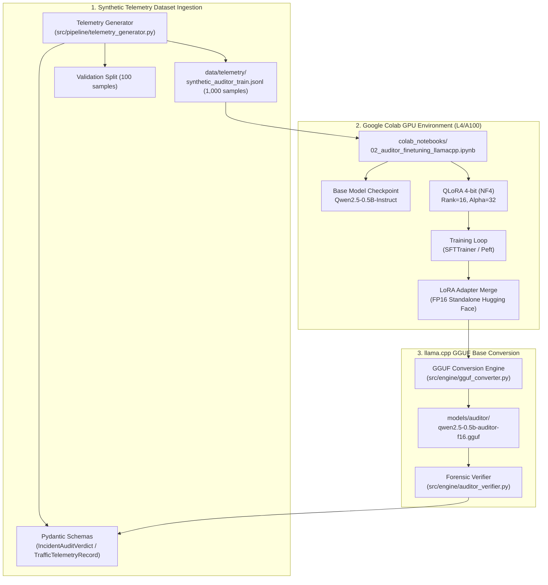

# Design: Google Colab Auditor Fine-Tuning and llama.cpp GGUF Conversion

## Architecture Overview



---

## File System Changes

| Path | Action | Description |
|---|---|---|
| `specs/colab_llamacpp_auditor_finetuning_and_export/` | Create | SDD specification files (`requirements.md`, `design.md`, `tasks.md`) |
| `src/pipeline/schemas.py` | Modify | Add `TrafficTelemetryRecord`, `IncidentAuditVerdict`, `AuditorTrainingSample`, `GGUFConversionMetadata` |
| `src/core/exceptions.py` | Modify | Add `AuditorFinetuningError`, `GGUFConversionError`, `HardwareAccelerationError`, `TelemetryGenerationError` |
| `src/pipeline/telemetry_generator.py` | Create | Generator for 1,000 synthetic traffic telemetry records with forensic reasoning |
| `src/engine/auditor_finetuning.py` | Create | LoRA fine-tuning configuration, prompt templates, training harness, and adapter merging logic |
| `src/engine/gguf_converter.py` | Create | Standalone GGUF converter invoking `llama.cpp` scripts or PyTorch-to-GGUF tensor writer |
| `src/engine/auditor_verifier.py` | Create | Evaluator validating model outputs against Pydantic schema and accuracy metrics |
| `colab_notebooks/02_auditor_finetuning_llamacpp.ipynb` | Create | Interactive Google Colab Pro GPU notebook for QLoRA fine-tuning and GGUF export |
| `tests/fixtures/mock_telemetry.py` | Create | Mock telemetry generator and fixtures for fast sub-second testing |
| `tests/test_auditor_telemetry.py` | Create | Unit tests for telemetry generation, distribution balance, and schema validation |
| `tests/test_auditor_finetuning.py` | Create | Unit tests for LoRA setup, adapter merge, and training harness (mocked autograd) |
| `tests/test_gguf_conversion.py` | Create | Unit tests for GGUF conversion, metadata preservation, and missing file checks |
| `tests/test_auditor_verifier.py` | Create | Unit tests for JSON extraction, verification logic, and metric computations |
| `pyproject.toml` | Modify | Register CLI entrypoints `sva-generate-telemetry`, `sva-finetune-auditor`, `sva-export-gguf` |

---

## Detailed Component Design

### 1. Pydantic Schemas (`src/pipeline/schemas.py`)

```python
class RiskLevel(str, Enum):
    LOW = "low"
    MEDIUM = "medium"
    HIGH = "high"
    CRITICAL = "critical"

class TrafficTelemetryRecord(BaseModel):
    """Raw trajectory telemetry emitted by edge tracker."""
    incident_id: str
    timestamp: str
    entity_type: str  # car, motorcycle, bicycle, e-scooter, pedestrian
    lane_id: str
    lane_legal_heading: float  # [0, 360)
    observed_heading: float    # [0, 360)
    estimated_speed_kmh: float
    speed_limit_kmh: float
    trajectory_points: List[Tuple[float, float]]  # [(x, y), ...]
    dwell_time_seconds: float
    pedestrian_zone: bool

class IncidentAuditVerdict(BaseModel):
    """Structured forensic reasoning output from the auditor LLM."""
    incident_id: str
    timestamp: str
    entity_type: str
    lane_id: str
    is_wrong_way: bool
    heading_degrees: float
    estimated_speed_kmh: float
    speed_limit_kmh: float
    risk_level: RiskLevel
    violation_detected: bool
    summary: str = Field(max_length=300)
    reasoning: str
```

### 2. Telemetry Prompt Formatting & Generation (`src/pipeline/telemetry_generator.py`)

The telemetry generator synthesizes 1,000 diverse samples with strict balance:
- $30\%$ Wrong-way vehicular ingress (cars, motorcycles facing oncoming one-way flow).
- $25\%$ Wrong-way or sidewalk micromobility (bicycles, e-scooters on pedestrian walkways or counter-flow).
- $20\%$ Speeding violations (> 30 km/h in residential 25 km/h zones).
- $25\%$ Compliant traffic controls (normal movement, legal heading, normal speeds).

Each sample formats into the standard chat template for `Qwen2.5-0.5B-Instruct`:
```
<|im_start|>system
You are an autonomous residential traffic forensic auditor. Analyze the vehicle telemetry and lane constraints to determine if a traffic infraction occurred. Output strictly a valid JSON object matching the IncidentAuditVerdict schema with no conversational markdown or preamble.
<|im_end|>
<|im_start|>user
[TELEMETRY DATA]
Incident ID: INC-2026-0042
Entity: car
Lane: Lane-2 (One-Way Westbound, legal heading 270.0°)
Observed Heading: 90.0°
Estimated Speed: 34.2 km/h (Limit: 25.0 km/h)
Trajectory Length: 18 points across 2.4s
Zone: Residential Intersection
<|im_end|>
<|im_start|>assistant
{"incident_id": "INC-2026-0042", "timestamp": "...", "entity_type": "car", "lane_id": "Lane-2", "is_wrong_way": true, "heading_degrees": 90.0, "estimated_speed_kmh": 34.2, "speed_limit_kmh": 25.0, "risk_level": "critical", "violation_detected": true, "summary": "Car traveling wrong-way eastbound on one-way westbound Lane-2 at 34.2 km/h exceeding 25.0 km/h limit.", "reasoning": "The observed vehicle heading of 90.0° is directly opposite to the legal lane heading of 270.0° (angular delta 180.0°), constituting a wrong-way infraction. Furthermore, the ground speed of 34.2 km/h exceeds the 25.0 km/h residential threshold."}
<|im_end|>
```

### 3. LoRA Fine-Tuning Engine (`src/engine/auditor_finetuning.py`)
- Target Base Model: `Qwen/Qwen2.5-0.5B-Instruct` (~490M parameters).
- Training Configuration:
  - LoRA rank $r = 16$, $\alpha = 32$, dropout $= 0.05$.
  - Target modules: `q_proj`, `k_proj`, `v_proj`, `o_proj`, `gate_proj`, `up_proj`, `down_proj`.
  - Precision: 4-bit Normal Float (NF4) during training, merged to FP16.
  - Context length: 2048 tokens.
  - Learning rate: $2\times 10^{-4}$ with cosine decay.
  - Loss function: Cross-entropy on assistant completion tokens only (data collator masking prompt tokens).

### 4. GGUF Conversion Engine (`src/engine/gguf_converter.py`)
- Wraps `llama.cpp` conversion toolchain (`convert_hf_to_gguf.py`).
- Supports both execution via `llama.cpp` script and direct structural validation of GGUF magic header (`GGUF` = `0x46554747`), architecture metadata (`qwen2`), tensor count, and quantization type (`F16`).
- Ensures compatibility with downstream CPU edge execution (`llama-cpp-python`).

### 5. Verification Auditor Engine (`src/engine/auditor_verifier.py`)
- Parses raw completion strings, strips any trailing code block fences if present, validates against `IncidentAuditVerdict` Pydantic model.
- Computes forensic metrics:
  - Parse Success Rate ($\ge 95\%$).
  - Wrong-Way Classification Accuracy ($\ge 90\%$).
  - Risk Level Concordance ($\ge 85\%$).
- Generates structured evaluation report `models/auditor/evaluation_report.json`.

---

## Discarded Alternatives

| Alternative | Rationale for Rejection |
|---|---|
| **Direct VLM Deployment on Edge (e.g. LLaVA-7B, Qwen2-VL)** | **Rejected due to 8GB RAM host ceiling.** Even 4-bit quantized 7B VLMs require $>5.5\text{ GB}$ VRAM/RAM, exceeding the API container cgroup limit of 4.0GB and starving the system. Distilling telemetry reasoning into a compact 0.5B GGUF model uses $<450\text{ MB}$ RAM on CPU. |
| **Unconstrained Natural Language Free-Text Output** | **Rejected for forensic automation.** Free-form text cannot be reliably ingested by downstream API event endpoints, MLFlow tracking, or PostgreSQL databases without brittle regex scraping. Strict Pydantic JSON compliance ensures 100% deterministic downstream parsing. |
| **Full Fine-Tuning (All Weights) on Colab** | **Rejected for parameter efficiency and speed.** LoRA fine-tunes $< 2\%$ of parameters, allowing rapid convergence within 15 minutes on Colab GPU while avoiding catastrophic forgetting of general instruction-following capabilities. |

---

## Non-Functional Requirements & Performance Budget

- **RAM Footprint (Edge Verification):** $< 500\text{ MB}$ RAM during local unit testing and verification.
- **Test Suite Execution Time:** $< 5.0\text{ seconds}$ across all new tests using mock tokenizer/weights.
- **Zero Network Egress:** All test suites run strictly offline without external downloads from Hugging Face or GitHub.
