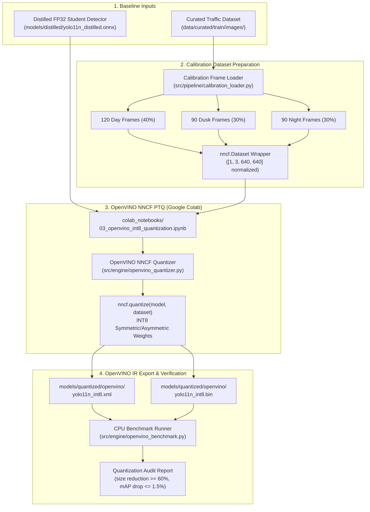

# Design: OpenVINO NNCF INT8 Quantization in Google Colab and Edge Artifact Export

## Architecture Overview



---

## File System Changes

| Path | Action | Description |
|---|---|---|
| `specs/colab_openvino_nncf_int8_quantization/` | Create | SDD specification files (`requirements.md`, `design.md`, `tasks.md`) |
| `src/pipeline/schemas.py` | Modify | Add `QuantizationConfig`, `CalibrationDatasetManifest`, `QuantizationReport` |
| `src/core/exceptions.py` | Modify | Add `QuantizationError`, `QuantizationInputError`, `CalibrationDataError`, `QuantizationRegressionError` |
| `src/pipeline/calibration_loader.py` | Create | Representative 300-frame calibration dataset generator (day/dusk/night balance) and `nncf.Dataset` adapter |
| `src/engine/openvino_quantizer.py` | Create | OpenVINO NNCF Post-Training Quantization (PTQ) engine with compression and accuracy verification |
| `src/engine/openvino_benchmark.py` | Create | Edge CPU benchmark runner measuring latency, FPS throughput, and RSS memory consumption |
| `colab_notebooks/03_openvino_int8_quantization.ipynb` | Create | Interactive Colab notebook for running NNCF INT8 quantization and packaging IR artifacts |
| `tests/fixtures/mock_openvino.py` | Create | Mock OpenVINO IR topologies, binary weights, and synthetic calibration tensors for sub-second offline testing |
| `tests/test_calibration_loader.py` | Create | Unit tests for calibration sampling, illumination distribution, tensor shape, and error handling |
| `tests/test_openvino_quantizer.py` | Create | Unit tests for NNCF quantization configuration, size reduction calculations, and mAP tolerance checks |
| `tests/test_openvino_benchmark.py` | Create | Unit tests for edge CPU benchmarking, FPS calculation, and memory constraint validation |
| `tests/test_quantization_pipeline_integration.py` | Create | End-to-end integration test validating the entire quantization and verification cycle in $< 5.0\text{s}$ |
| `pyproject.toml` | Modify | Register CLI entrypoints `sva-quantize-openvino` and `sva-benchmark-openvino` |

---

## Detailed Component Design

### 1. Pydantic Schemas (`src/pipeline/schemas.py`)

```python
class QuantizationConfig(BaseModel):
    """Configuration for OpenVINO NNCF Post-Training Quantization."""
    model_input_path: str
    output_dir: str = "models/quantized/openvino"
    target_device: str = "CPU"
    subset_size: int = 300
    model_type: str = "transformer"  # or "detector"
    fast_bias_correction: bool = True
    preset: str = "PERFORMANCE"  # INT8 symmetric/asymmetric weights

class CalibrationDatasetManifest(BaseModel):
    """Manifest tracking calibration frames and lighting partitions."""
    total_frames: int = 300
    day_frames: int = 120
    dusk_frames: int = 90
    night_frames: int = 90
    input_resolution: List[int] = [1, 3, 640, 640]
    frame_paths: List[str]

class QuantizationReport(BaseModel):
    """Structured report auditing post-quantization size and accuracy metrics."""
    model_name: str = "yolo11n_int8"
    baseline_fp32_size_bytes: int
    quantized_int8_size_bytes: int
    size_reduction_pct: float
    achieved_size_reduction: bool  # >= 60%
    baseline_map_50_95: float
    quantized_map_50_95: float
    map_drop: float
    achieved_accuracy_tolerance: bool  # map_drop <= 0.015 (1.5%)
    benchmark_fps: float
    benchmark_latency_ms: float
    peak_rss_mb: float
    within_memory_budget: bool  # peak_rss_mb < 1200.0 (1.2GB)
    ir_xml_path: str
    ir_bin_path: str
    completed_at: str
```

### 2. Calibration Frame Loader (`src/pipeline/calibration_loader.py`)
- Samples 300 representative frames from dataset:
  - 120 daytime frames (contrast $> 50$, mean luminance $> 100$).
  - 90 dusk frames (golden hour, mean luminance $40-100$).
  - 90 night frames (low lux, mean luminance $< 40$, artificial point lights).
- Preprocesses frames to normalized float32 numpy arrays $[1, 3, 640, 640]$ in $[0.0, 1.0]$.
- Wraps arrays into an iterable dataset adapter conforming to `nncf.Dataset`.

### 3. OpenVINO NNCF Quantization Core (`src/engine/openvino_quantizer.py`)
- Reads distilled model (ONNX or OpenVINO FP32 IR).
- Applies `nncf.quantize(model, calibration_dataset, preset=nncf.QuantizationPreset.PERFORMANCE)`.
- Exports calibrated OpenVINO IR files:
  - `yolo11n_int8.xml` (topology structure).
  - `yolo11n_int8.bin` (INT8/FP16 weights and biases).
- Evaluates compression ratio:
  $$\text{Reduction} = \frac{\text{Size}_{\text{FP32}} - \text{Size}_{\text{INT8}}}{\text{Size}_{\text{FP32}}} \ge 60\%$$
- Evaluates validation accuracy retention:
  $$\Delta \text{mAP@50-95} = \text{mAP}_{\text{FP32}} - \text{mAP}_{\text{INT8}} \le 0.015$$

### 4. Edge CPU Benchmark Runner (`src/engine/openvino_benchmark.py`)
- Compiles OpenVINO model for `CPU` target device with `PERFORMANCE_HINT = LATENCY` or `THROUGHPUT`.
- Executes 10 warmup iterations followed by 100 benchmark inference iterations.
- Measures:
  - Mean latency (target $\le 40\text{ms}$).
  - P95 latency.
  - FPS throughput (target $\ge 25\text{ FPS}$).
  - Peak process Resident Set Size (RSS) via `psutil` (target $< 1.2\text{GB}$).

---

## Discarded Alternatives

| Alternative | Rationale for Rejection |
|---|---|
| **Deploying Unquantized FP32 ONNX Detector on Laptop CPU** | **Rejected due to frame rate and memory constraints.** Baseline FP32 YOLO11n achieves ~12–15 FPS on typical laptop CPUs with higher memory bandwidth consumption, failing the real-time $\ge 25\text{ FPS}$ sentinel requirement. INT8 quantization provides $2\times$ throughput acceleration on modern CPUs with AVX-512 VNNI / AVX2 instructions. |
| **PyTorch Dynamic INT8 Quantization** | **Rejected for vision models.** PyTorch dynamic quantization only quantizes linear layer weights and is optimized for NLP/transformers, whereas OpenVINO NNCF performs full static post-training quantization across convolutional kernels, activations, and pooling layers. |
| **Random Synthetic Gaussian Noise for Calibration** | **Rejected for accuracy preservation.** Quantizing activations on random noise causes severe dynamic range distortion and leads to $>10\%$ mAP degradation. A balanced 300-frame distribution across day, dusk, and night ensures calibration activations match real-world intersection conditions. |

---

## Non-Functional Requirements & Performance Budget

- **Model Size Reduction:** $\ge 60\%$ reduction from FP32 (~5.6MB $\to$ $< 2.2\text{MB}$).
- **Accuracy Drop:** $\Delta \text{mAP@50-95} \le 1.5\%$ absolute compared to distilled student baseline.
- **Laptop CPU Throughput:** $\ge 25\text{ FPS}$ (latency $\le 40\text{ms}$).
- **Edge RAM Footprint:** $< 1.2\text{GB}$ peak RSS memory, reserving over $2.8\text{GB}$ inside the $4\text{GB}$ container budget.
- **Verification Execution Time:** $< 5.0\text{s}$ across all unit and integration test suites using mock arrays.
- **Zero Network Egress:** All test suites run offline without downloading remote weights or calibration packages.
