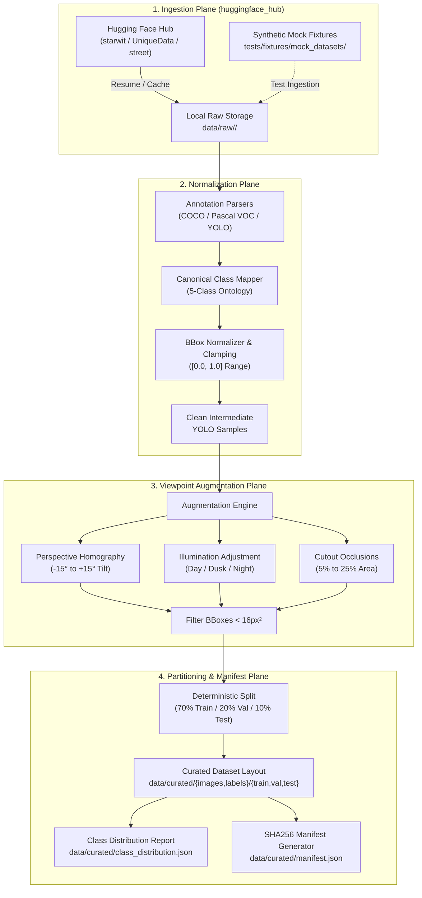

# Design: Hugging Face Multimodal Traffic & Micromobility Dataset Ingestion

## Feature Metadata
- **ID:** SVA-DATA-001
- **Name:** huggingface_dataset_acquisition_and_curation
- **Status:** spec_ready
- **Target Subsystem:** `src/pipeline/` (Ingestion, Normalization, Augmentation & Splitting)
- **Data Target:** `data/raw/` and `data/curated/`

---

## 1. Architectural Overview

The SVA Sentinel system requires a diverse, high-quality object detection dataset covering residential intersections with a focus on multimodal traffic and micromobility: automobiles, motorcycles, bicycles, electric scooters, and pedestrians. Public datasets on Hugging Face Hub (such as `starwit/overhead-traffic-anomalies`, `UniqueData/electric-scooters-tracking`, and street-level vehicle subsets) feature heterogeneous coordinate representations (COCO JSON pixel bounding boxes, Pascal VOC XML absolute coordinates, and arbitrary label strings).

Feature `SVA-DATA-001` provides a unified, deterministic data engineering pipeline inside `src/pipeline/` that downloads, normalizes, filters, augments, deterministically partitions, and cryptographically seals the dataset into standard YOLO TXT format ready for training YOLO11 teacher and student architectures in Google Colab and edge deployment.

### 1.1 Data Flow Pipeline



---

## 2. Technical Decisions & Schemas

### 2.1 Code Organization (User Constraint #1)
All implementation source code strictly resides inside `src/` to adhere to project architectural boundaries:
- `src/pipeline/dataset_ingest.py`: Hugging Face Hub downloader with snapshot resumption, offline cache support, and error containment.
- `src/pipeline/dataset_curation.py`: Annotation parsers (COCO, VOC, YOLO), ontology mapping, coordinate normalization, bounding box clipping, and geometric/photometric augmentations.
- `src/pipeline/dataset_split.py`: Deterministic pseudorandom splitting (70/20/10), class balance verification, and SHA256 integrity manifest generation.
- `src/pipeline/schemas.py`: Pydantic models for annotation structures, dataset manifests, and curation configuration.
- `src/core/exceptions.py`: Domain-specific exceptions (`DatasetIngestError`, `AnnotationFormatError`, `CurationError`).

Raw downloaded datasets live in `data/raw/<dataset_name>/`, and curated YOLO artifacts live in `data/curated/`.

### 2.2 Canonical YOLO Schema & Ontology

#### Canonical Class Ontology
| Canonical ID | Canonical Class Name | Source Synonyms Mapped |
|:---:|:---:|:---|
| `0` | `car` | `car`, `automobile`, `sedan`, `suv`, `van`, `truck`, `bus`, `vehicle` |
| `1` | `motorcycle` | `motorcycle`, `motorbike`, `moto`, `scooter_gas`, `moped` |
| `2` | `bicycle` | `bicycle`, `bike`, `cyclist`, `bicyclist` |
| `3` | `e-scooter` | `e-scooter`, `escooter`, `electric_scooter`, `kick_scooter`, `scooter_electric` |
| `4` | `pedestrian` | `pedestrian`, `person`, `walker`, `ped` |

Unmapped or irrelevant classes (e.g. `traffic_light`, `stop_sign`, `dog`, `tree`) are filtered out during ingestion.

#### YOLO TXT Annotation Specification
For an image file `data/curated/images/<split>/<stem>.<ext>`, the corresponding label file is `data/curated/labels/<split>/<stem>.txt`.
Each line contains exactly 5 space-delimited values:
```text
<class_id> <x_center> <y_center> <width> <height>
```
Where:
- `class_id`: Integer in `[0, 4]` corresponding to the canonical ontology.
- `x_center`: Horizontal center coordinate normalized to `[0.0, 1.0]` relative to image width $W$.
- `y_center`: Vertical center coordinate normalized to `[0.0, 1.0]` relative to image height $H$.
- `width`: Bounding box width normalized to `[0.0, 1.0]` relative to image width $W$.
- `height`: Bounding box height normalized to `[0.0, 1.0]` relative to image height $H$.

#### Mathematical Conversion Formulas

1. **From COCO JSON Bounding Box `[x_min, y_min, w, h]`:**
   $$x_{center} = \frac{x_{min} + \frac{w}{2}}{W}, \quad y_{center} = \frac{y_{min} + \frac{h}{2}}{H}$$
   $$width = \frac{w}{W}, \quad height = \frac{h}{H}$$

2. **From Pascal VOC XML Bounding Box `[xmin, ymin, xmax, ymax]`:**
   $$w = x_{max} - x_{min}, \quad h = y_{max} - y_{min}$$
   $$x_{center} = \frac{x_{min} + x_{max}}{2 \cdot W}, \quad y_{center} = \frac{y_{min} + y_{max}}{2 \cdot H}$$
   $$width = \frac{w}{W}, \quad height = \frac{h}{H}$$

3. **Box Clamping & Filtering Criteria:**
   - Coordinate clamping: $x_{min} = \max(0, x_{min})$, $y_{min} = \max(0, y_{min})$, $x_{max} = \min(W, x_{max})$, $y_{max} = \min(H, y_{max})$.
   - Valid area check: $(x_{max} - x_{min}) \times (y_{max} - y_{min}) \ge 16\text{ px}^2$.
   - Normalized limits: $0.0 \le x_{center} \le 1.0$, $0.0 \le y_{center} \le 1.0$, $0.0 < width \le 1.0$, $0.0 < height \le 1.0$.

---

### 2.3 Viewpoint-Specific Augmentations

Intersection surveillance cameras are typically mounted at elevations between 3 to 6 meters with ground-facing pitch angles. Raw datasets collected from horizontal dashcams or overhead drones exhibit severe viewpoint mismatch. The augmentation engine applies three targeted transforms:

1. **Perspective Homography Warp:**
   - Simulates intersection camera pitch and yaw variation:
     $$\mathbf{H}_{aug} = \begin{bmatrix} 1 & \tan(\phi_x) & 0 \\ \tan(\phi_y) & 1 & 0 \\ p_x & p_y & 1 \end{bmatrix}$$
   - Pitch angle variation $\theta_{pitch} \in [-15^\circ, +15^\circ]$.
   - Bounding boxes are projected through the forward transformation and re-bounded by the minimum enclosing axis-aligned rectangle:
     $$x'_{min} = \min_i(x'_i), \quad x'_{max} = \max_i(x'_i)$$
     $$y'_{min} = \min_i(y'_i), \quad y'_{max} = \max_i(y'_i)$$

2. **Photometric Illumination Variations:**
   - Linear contrast scaling: $I_{out} = \alpha \cdot I_{in} + \beta$, with $\alpha \in [0.6, 1.4]$ and $\beta \in [-30, 30]$.
   - Gamma correction: $I_{out} = 255 \times \left(\frac{I_{in}}{255}\right)^\gamma$, with $\gamma \in [0.7, 1.4]$, simulating dusk, twilight, shadows, and headlight glare.

3. **Synthetic Occlusion (Cutout):**
   - Injects 1 to 3 rectangular cutout masks covering $5\%$ to $25\%$ of total image area filled with random noise or constant pavement tone ($RGB \approx [80, 80, 80]$), simulating occluding utility poles, road signs, or passing trucks.
   - Bounding boxes overlapping an occlusion by $> 85\%$ area or resulting in $< 16\text{ px}^2$ visible extent are pruned.

---

### 2.4 Deterministic 70/20/10 Stratified Partitioning

To prevent data leakage across video sequences while preserving balanced class representation:
- Images originating from identical video scenes/sequences are grouped together so that no scene spans multiple splits.
- Split ratios: 70% Train, 20% Validation, 10% Test.
- Seed control: Pseudo-random generator initialized with fixed seed (`seed = 42`).
- Target distribution constraint: Relative class frequencies in validation and test sets must remain within $\pm 5\%$ of the master curated dataset distribution.

#### Directory Layout
```
data/curated/
├── images/
│   ├── train/
│   ├── val/
│   └── test/
├── labels/
│   ├── train/
│   ├── val/
│   └── test/
├── class_distribution.json
├── manifest.json
└── dataset.yaml
```

---

### 2.5 Cryptographic Integrity Manifest

Every generated file in `data/curated/` is cataloged in `data/curated/manifest.json`:
```json
{
  "dataset_version": "1.0.0",
  "generated_at": "2026-11-01T23:30:00Z",
  "seed": 42,
  "summary": {
    "total_images": 5000,
    "total_annotations": 18500,
    "splits": {
      "train": {"images": 3500, "annotations": 12950},
      "val": {"images": 1000, "annotations": 3700},
      "test": {"images": 500, "annotations": 1850}
    }
  },
  "files": [
    {
      "path": "images/train/starwit_001.jpg",
      "sha256": "e3b0c44298fc1c149afbf4c8996fb92427ae41e4649b934ca495991b7852b855",
      "bytes": 245120
    },
    {
      "path": "labels/train/starwit_001.txt",
      "sha256": "4b227777d4dd1fc61c6f884f48641d02b4d121d3fd328cb08b5531fcacdabf8a",
      "bytes": 142
    }
  ]
}
```

---

## 3. Container Memory Allocation & Resource Budget

The target edge environment operates under an aggregate **8GB host RAM budget**:
- API / Inference runtime: 4.0 GB cap.
- MLFlow tracking server: 1.5 GB cap.
- Next.js dashboard: 1.0 GB cap.
- Host system reserve: 1.5 GB.

### Curation Pipeline Execution Profile
Dataset ingestion and curation operates as a preprocessing / batch utility:
- **Memory Ceiling:** The curation process SHALL NOT exceed **2.0 GB RSS memory**.
- **Batch Processing Strategy:** Image loading and augmentation MUST operate lazily or via streaming batches of 32 frames rather than loading the entire dataset into memory.
- **Disk Footprint:** Cache directory uses symlink/hardlink optimization where supported to avoid duplicating large raw image files.

---

## 4. Dependencies (`pyproject.toml`)

The following dependencies are required to fulfill `SVA-DATA-001`:
1. `huggingface-hub>=0.25.0`: Ingestion client providing `snapshot_download`, resume capability, and local cache management.
2. `opencv-python-headless>=4.10.0`: Already present in `pyproject.toml`; utilized for perspective warping, lighting, and geometric computations without heavy X11 GUI dependencies.
3. `pydantic>=2.9.0`: Already present in `pyproject.toml`; enforces validation for manifests, class statistics, and ingest configurations.
4. `pyyaml>=6.0.2`: Already present; generates YOLO `dataset.yaml` descriptors.

*Note:* PyTorch and torchvision are strictly **NOT** added to the edge environment runtime, avoiding >1.5GB of container bloat.

---

## 5. Discarded Alternatives

### Alternative 1: On-the-fly Streaming Dataset Ingestion during Training
- *Description:* Directly stream raw Hugging Face parquet/webdataset archives over HTTP into PyTorch DataLoader workers during training.
- *Why Discarded:* Requires continuous outbound internet connectivity, introduces non-deterministic network latency, violates the sovereign environment's "Zero External Network Egress" constraint, and prevents offline INT8 NNCF calibration in Colab and edge containers.

### Alternative 2: Retaining COCO JSON as Canonical Training Format
- *Description:* Keep all annotations in a monolithic `instances_train.json` file.
- *Why Discarded:* YOLO11 native training requires per-image `.txt` labels in standard YOLO format. Loading a multi-gigabyte COCO JSON into memory during edge inspection causes excessive memory consumption that breaches the 2.0GB memory ceiling.

### Alternative 3: Using Heavy External Augmentation Frameworks (Albumentations / Torchvision)
- *Description:* Import `torchvision` or `albumentations` with heavy C++ / PyTorch backend dependencies.
- *Why Discarded:* Would add hundreds of megabytes of unnecessary binary dependencies to the edge environment. Lightweight vectorized NumPy and OpenCV transforms provide all required homographies, illumination, and cutout filters with zero extra dependency overhead.

---

## 6. Verification & Fast Unit Testing Strategy

To adhere to the requirement of executing unit tests in under 5 seconds with zero external network egress:
- `tests/fixtures/mock_datasets/`: Contains miniature synthetic datasets (3 images, COCO JSON, Pascal VOC XML, raw annotations) representing each source dataset format.
- Ingestion tests mock `huggingface_hub.snapshot_download` and `hf_hub_download` using `unittest.mock.patch` to redirect requests to `tests/fixtures/mock_datasets/`.
- All coordinate calculations, clamping, format conversions, and manifest hashes are verified with analytical ground truth values.
