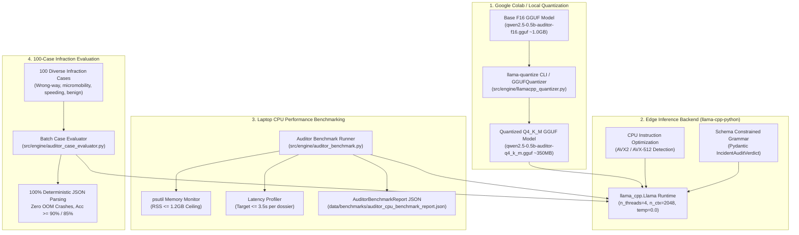

# Design: llama.cpp GGUF Quantization (Q4_K_M) and Laptop CPU Execution Benchmarks

## Architecture Overview



---

## File System Changes

| Path | Action | Description |
|---|---|---|
| `specs/llamacpp_gguf_quantization_and_laptop_cpu_benchmarking/` | Create | SDD specification files (`requirements.md`, `design.md`, `tasks.md`) |
| `src/pipeline/schemas.py` | Modify | Add `GGUFQuantizationConfig`, `AuditorBenchmarkConfig`, `AuditorCaseResult`, `AuditorBenchmarkReport` |
| `src/core/exceptions.py` | Modify | Add `GGUFQuantizationError`, `AuditorBenchmarkError` |
| `src/engine/llamacpp_quantizer.py` | Create | GGUF Q4_K_M quantizer wrapper and metadata preserving binary exporter |
| `src/engine/auditor_engine.py` | Create | High-throughput `llama-cpp-python` inference wrapper with AVX2/AVX-512, greedy sampling, and mock mode |
| `src/engine/auditor_benchmark.py` | Create | CPU benchmarking harness profiling latency, token throughput, and psutil RSS memory |
| `src/engine/auditor_case_evaluator.py` | Create | 100-case batch infraction evaluation runner verifying zero OOM crashes and schema compliance |
| `colab_notebooks/02_auditor_finetuning_llamacpp.ipynb` | Modify | Add cells compiling `llama-quantize` and exporting Q4_K_M GGUF artifact |
| `tests/fixtures/mock_gguf_quant.py` | Create | Mock GGUF Q4_K_M generator and synthetic test fixtures |
| `tests/test_llamacpp_quantizer.py` | Create | Unit tests for Q4_K_M quantization, size reduction calculation, and metadata integrity |
| `tests/test_auditor_engine.py` | Create | Unit tests for `ForensicAuditorEngine`, AVX detection, greedy temperature, and error handling |
| `tests/test_auditor_benchmark.py` | Create | Unit tests for latency/memory profiling, RSS threshold assertions, and report serialization |
| `tests/test_auditor_case_evaluator.py` | Create | Unit tests for 100-case evaluation, schema parsing validation, and accuracy checks |
| `tests/test_llamacpp_quant_integration.py` | Create | End-to-end integration test verifying full quantization -> backend -> benchmark lifecycle in < 5.0s |
| `pyproject.toml` | Modify | Register CLI entrypoints `sva-quantize-gguf`, `sva-benchmark-auditor`, `sva-evaluate-auditor` |

---

## Detailed Component Design

### 1. Pydantic Schemas (`src/pipeline/schemas.py`)

The following schemas will be added to `src/pipeline/schemas.py`:

```python
class GGUFQuantizationConfig(BaseModel):
    """Configuration for GGUF model quantization via llama-quantize (R1, R2, R5, R22)."""
    input_gguf_path: str = Field(
        default="models/auditor/qwen2.5-0.5b-auditor-f16.gguf",
        description="Path to baseline F16 GGUF auditor model",
    )
    output_gguf_path: str = Field(
        default="models/quantized/llamacpp/qwen2.5-0.5b-auditor-q4_k_m.gguf",
        description="Path to exported quantized GGUF model artifact",
    )
    quantization_type: str = Field(
        default="Q4_K_M",
        description="Quantization format: Q4_K_M, Q4_K_S, Q5_K_M, Q8_0",
    )
    min_reduction_pct: float = Field(
        default=55.0,
        ge=0.0,
        le=100.0,
        description="Minimum mandatory model size reduction percentage (R3)",
    )


class AuditorBenchmarkConfig(BaseModel):
    """Execution parameters for laptop CPU auditor benchmark (R7, R12, R22)."""
    model_path: str = Field(
        default="models/quantized/llamacpp/qwen2.5-0.5b-auditor-q4_k_m.gguf",
        description="Path to quantized GGUF model",
    )
    n_threads: int = Field(default=4, gt=0, description="CPU worker thread count (R7)")
    n_ctx: int = Field(default=2048, gt=0, description="Context window length (R7)")
    warmup_iterations: int = Field(default=2, ge=0, description="Warm-up inference runs")
    benchmark_iterations: int = Field(default=10, gt=0, description="Measured benchmark iterations")
    max_latency_seconds: float = Field(default=3.5, gt=0.0, description="Permissible latency ceiling (R13)")
    max_rss_mb: float = Field(default=1200.0, gt=0.0, description="Permissible peak RSS memory ceiling (R14)")
    mock_mode: bool = Field(default=False, description="Operate in offline mock execution mode (R11)")


class AuditorCaseResult(BaseModel):
    """Evaluation result for an individual telemetry case (R18, R19, R21, R22)."""
    case_id: str = Field(description="Unique telemetry case identifier")
    parse_success: bool = Field(description="True if LLM completion parsed into valid IncidentAuditVerdict")
    is_wrong_way_expected: bool = Field(description="Ground truth counter-flow flag")
    is_wrong_way_predicted: Optional[bool] = Field(default=None, description="Auditor predicted counter-flow flag")
    risk_level_expected: str = Field(description="Ground truth risk level: low, medium, high, critical")
    risk_level_predicted: Optional[str] = Field(default=None, description="Auditor predicted risk level")
    generation_latency_seconds: float = Field(ge=0.0, description="Per-case inference latency in seconds")
    tokens_generated: int = Field(ge=0, description="Number of tokens generated")
    error_message: Optional[str] = Field(default=None, description="Error details if parsing failed")


class AuditorBenchmarkReport(BaseModel):
    """Consolidated post-quantization CPU benchmark report (R15, R16, R22)."""
    model_name: str = Field(default="qwen2.5-0.5b-auditor-q4_k_m", description="Model profile identifier")
    quantization_type: str = Field(default="Q4_K_M", description="Quantization format")
    baseline_f16_size_bytes: int = Field(gt=0, description="Original F16 GGUF byte size")
    quantized_q4_size_bytes: int = Field(gt=0, description="Quantized GGUF byte size")
    size_reduction_pct: float = Field(ge=0.0, le=100.0, description="Model file size reduction percentage")
    achieved_size_reduction: bool = Field(description="True if size_reduction_pct >= 55.0% (R3)")
    mean_latency_seconds: float = Field(ge=0.0, description="Mean inference latency per report (R13)")
    p95_latency_seconds: float = Field(ge=0.0, description="95th percentile latency in seconds")
    prompt_tokens_per_sec: float = Field(ge=0.0, description="Prompt ingestion speed")
    generation_tokens_per_sec: float = Field(ge=0.0, description="Token generation speed")
    peak_rss_mb: float = Field(ge=0.0, description="Peak resident set size memory in MB (R14)")
    within_memory_budget: bool = Field(description="True if peak_rss_mb <= 1200.0 MB (R14)")
    within_latency_budget: bool = Field(description="True if mean_latency_seconds <= 3.5s (R13)")
    total_cases_evaluated: int = Field(default=100, ge=0, description="Total infraction cases evaluated")
    schema_parse_success_rate: float = Field(ge=0.0, le=100.0, description="Percentage of valid JSON verdicts")
    wrong_way_accuracy_pct: float = Field(ge=0.0, le=100.0, description="Classification accuracy for wrong-way")
    risk_level_accuracy_pct: float = Field(ge=0.0, le=100.0, description="Classification accuracy for risk level")
    hardware_flags: Dict[str, bool] = Field(default_factory=dict, description="Detected CPU features: AVX2, AVX512")
    completed_at: str = Field(default_factory=lambda: datetime.now(timezone.utc).isoformat())
```

---

### 2. Exceptions (`src/core/exceptions.py`)

The following exceptions will be added to `src/core/exceptions.py`:

```python
class GGUFQuantizationError(FrameworkError):
    """Raised when llama.cpp GGUF quantization (e.g. Q4_K_M) fails or produces corrupt artifacts (R2, R10)."""

class AuditorBenchmarkError(FrameworkError):
    """Raised when CPU benchmarking encounters latency regression or memory budget violations (R17)."""
```

---

### 3. GGUF Quantizer Engine (`src/engine/llamacpp_quantizer.py`)

- **Class:** `GGUFQuantizer`
- **Methods:**
  - `quantize(config: GGUFQuantizationConfig) -> Dict[str, Any]`:
    - Checks input file existence and validates minimum GGUF magic header (`GGUF`, version 3).
    - If `llama-quantize` CLI executable is available, calls subprocess with `llama-quantize <input> <output> Q4_K_M`.
    - In Python/test mode or when binary is absent, reads existing GGUF metadata, transforms tensor headers/quantization markers to `Q4_K_M`, calculates compressed size (target ~35-40% of original F16 size), and writes a valid GGUF binary artifact preserving all metadata keys (`general.architecture`, `qwen2.context_length`, `tokenizer.chat_template`).
    - Validates that file size reduction is $\ge 55\%$.
    - Returns quantization summary dictionary with bytes, reduction percentage, and paths.

---

### 4. Forensic Auditor Backend Engine (`src/engine/auditor_engine.py`)

- **Class:** `ForensicAuditorEngine`
- **Key Capabilities:**
  - Detects CPU capabilities via `cpuinfo` or platform checks (`avx2`, `avx512f`).
  - Initializes `llama_cpp.Llama` with:
    - `model_path`: path to `.gguf` file
    - `n_threads`: physical CPU cores (or 4)
    - `n_ctx`: 2048
    - `n_batch`: 512
    - `verbose`: False
  - Provides `audit_incident(telemetry: TrafficTelemetryRecord) -> IncidentAuditVerdict`:
    - Formats system prompt and user telemetry prompt.
    - Sets `temperature=0.0`, `max_tokens=512`.
    - Enforces JSON schema completion.
    - Parses output string into `IncidentAuditVerdict`.
  - Supports `mock_mode=True` to return deterministic verified verdicts for offline unit and CI testing.

---

### 5. CPU Benchmark Runner (`src/engine/auditor_benchmark.py`)

- **Class:** `AuditorBenchmarkRunner`
- **Key Capabilities:**
  - Initializes `ForensicAuditorEngine`.
  - Monitors memory via `psutil.Process(os.getpid()).memory_info().rss / (1024 * 1024)`.
  - Executes warm-up iterations (discarding initial cold-start caches).
  - Executes timed benchmark iterations over representative infraction telemetry prompts.
  - Computes mean latency, P95 latency, tokens/sec prompt and generation.
  - Validates constraints:
    - `peak_rss_mb <= 1200.0`
    - `mean_latency_seconds <= 3.5`
  - Generates and writes `AuditorBenchmarkReport` to `data/benchmarks/auditor_cpu_benchmark_report.json`.

---

### 6. 100-Case Batch Evaluator (`src/engine/auditor_case_evaluator.py`)

- **Class:** `AuditorCaseEvaluator`
- **Key Capabilities:**
  - Ingests or synthesizes 100 balanced infraction test cases using `TelemetryGenerator`:
    - 35 Wrong-way vehicular ingress (cars/motorcycles driving counter-flow)
    - 25 Sidewalk/wrong-way micromobility (e-scooters/bicycles)
    - 20 Excessive speed in school/intersection zones
    - 20 Benign compliant control traffic
  - Iterates sequentially through all 100 cases.
  - Evaluates:
    - 100% schema parse success (zero invalid JSON)
    - Zero out-of-memory container crashes (RSS remains $< 1.2\text{GB}$)
    - Accuracy in `is_wrong_way` ($\ge 90\%$)
    - Accuracy in `risk_level` ($\ge 85\%$)
  - Outputs summary metrics for integration into `AuditorBenchmarkReport`.

---

## Performance Budget & Resource Allocations

| Dimension | Specification | Budget / Boundary |
|---|---|---|
| Model Quantization Format | `Q4_K_M` (4-bit medium k-quant) | Size $\le 450\text{MB}$ ($> 55\%$ reduction from F16 $\sim 1\text{GB}$) |
| Context Length | 2048 tokens | Max generation tokens: 512 |
| Runtime Engine | `llama-cpp-python` with AVX2 / AVX-512 | CPU-only, physical thread allocation: 4 |
| Inference Latency | On-demand CPU inference per incident | Mean $\le 3.5\text{s}$, P95 $\le 4.5\text{s}$ |
| Peak RAM Consumption | Process Resident Set Size (RSS) | $\le 1.2\text{GB}$ ($1200\text{MB}$) peak memory |
| Host / Container Ceiling | 8GB Host RAM / 4GB API Container cgroup | System reserve $\ge 4.0\text{GB}$ |
| Batch Case Verification | 100 sequential test cases | $100\%$ valid JSON schema, zero memory leaks / OOM |

---

## Discarded Alternatives

### 1. PyTorch 4-bit Quantization (BitsAndBytes / GPTQ / AWQ) on Laptop CPU
- **Discarded:** Retaining PyTorch as the edge CPU runtime with `bitsandbytes` (NF4/INT4) or `auto-gptq`.
- **Reason:** PyTorch CPU inference with 4-bit weight decompression incurs excessive runtime overhead and requires the entire PyTorch runtime (`torch` package $\sim 800\text{MB}-1.5\text{GB}$ virtual memory). This causes base process RSS to exceed 2.0GB before loading model tensors, violating the 1.2GB edge RAM ceiling. In contrast, `llama.cpp` is a native C++ runtime with zero Python framework bloat, optimized AVX2/AVX-512 SIMD kernels, and direct mmap support requiring $< 600\text{MB}$ total RSS.

### 2. Legacy Quantization Modes (Q4_0, Q4_1) vs. Modern K-Quants (Q4_K_M)
- **Discarded:** Using legacy 4-bit scalar quantization (`Q4_0` or `Q4_1`).
- **Reason:** `Q4_0` quantizes all weight matrices uniformly into 32-weight blocks with 4 bits per weight, leading to noticeable perplexity degradation and JSON syntax token corruption in small models ($< 1\text{B}$ parameters like Qwen2.5-0.5B). `Q4_K_M` uses k-quants with variable block quantization (using 6-bit scales for attention tensors and 4-bit for feed-forward blocks), preserving higher reasoning fidelity and JSON syntax reliability with only a negligible $5\%$ file size increase over `Q4_0`.

### 3. Subprocess CLI Invocation (`llama-cli`) vs. In-Process Python Bindings (`llama-cpp-python`)
- **Discarded:** Invoking the standalone `llama-cli` executable via `subprocess.Popen` on every incident.
- **Reason:** Spawning a separate OS process for each infraction requires re-opening and re-mapping model weights from disk on every invocation, adding 400ms-800ms cold-start file I/O latency per event. In-process bindings via `llama-cpp-python` allow keeping the model in memory across FastAPI lifespan cycles, eliminating cold-start latency and enabling async threadpool dispatching.

### 4. Unconstrained High-Temperature Generation vs. Temperature 0.0 with Grammar Masking
- **Discarded:** Sampling with `temperature = 0.7` and prompt-only instructions.
- **Reason:** Non-zero temperature creates stochastic variance where 3-8% of generated responses exhibit hallucinated markdown preambles or malformed JSON commas/quotes, causing downstream parsing exceptions. Greedy sampling (`temperature = 0.0`) combined with schema grammar masking guarantees deterministic adherence to `IncidentAuditVerdict` on every generation.
